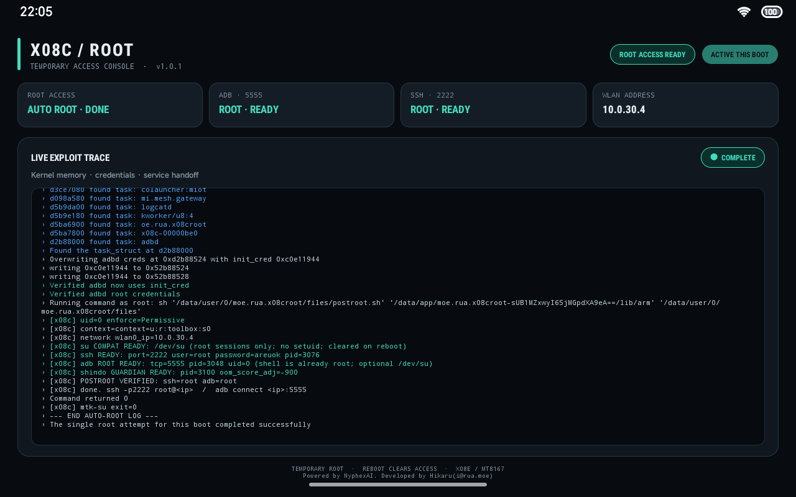
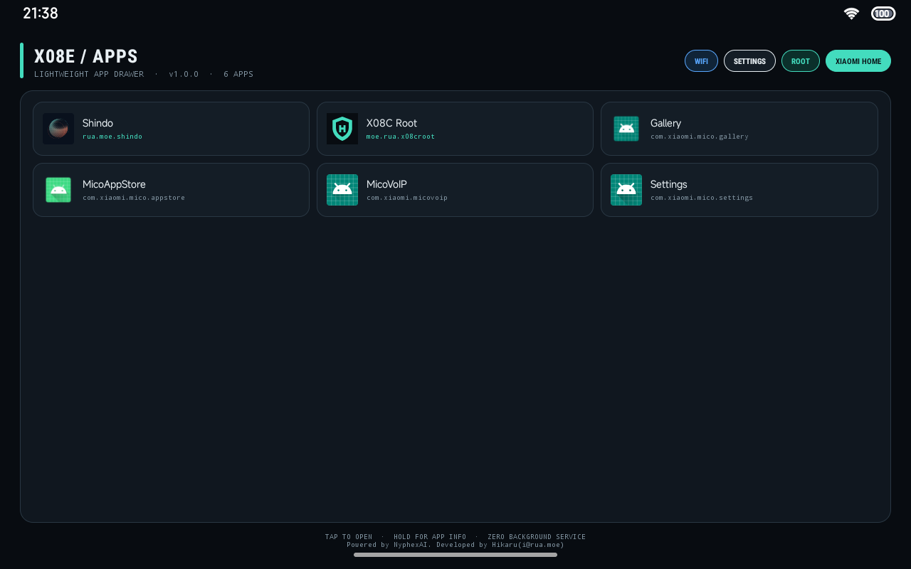

# Redmi小爱音箱Pro8：X08C Root / X08E Launcher

本仓库只发布两个 Android 应用：

| 应用 | 版本 | 包名 | 用途 |
| --- | --- | --- | --- |
| X08C Root | 1.0.1 | `moe.rua.x08croot` | MT8167 / Android 9 设备上的临时 root、root ADB 与临时 SSH |
| X08E Apps Launcher | 1.0.0 | `moe.rua.x08clauncher` | Redmi小爱音箱Pro8 的横屏轻量应用启动器 |

仓库不包含 boot 镜像、固件、设备备份、恢复脚本、私钥、开发日志或内部缓存。X08A、X08C 与 X08E 不是可以随意混用的型号；请先确认设备底部标签和系统硬件代号。

## 下载

请从 [Releases](https://github.com/HikaruChang/x08c_root/releases) 下载，不要从第三方网盘获取 APK：

- `x08c-root-v1.0.1.apk`
- `x08e-launcher-v1.0.0.apk`

每个 Release 同时提供独立的 `.sha256` 文件。仓库中的 [`dist/CHECKSUMS.sha256`](dist/CHECKSUMS.sha256) 是当前发布产物的固定校验值。

## X08C Root 1.0.1



这是易失性的临时 root 工具，不会把一次端口开放、普通 ADB shell 或静态构建成功当成 root 证明。实机成功判据要求提权后 UID 回读为 0，并分别确认 root ADB / SSH 的实际受保护效果。

重要安全限制：

- 仅在你拥有或明确获准测试的设备上使用。
- 工具启动的 SSH 使用公开临时凭据 `root` / `areuok`，只应在隔离、可信的局域网中短时使用。
- 使用结束后重启设备；不要把 2222 或 5555 端口暴露到互联网。
- 同一开机失败后不要反复触发内核路径，应重启后再诊断。
- 该 APK 不是启用 stock 设备 ADB 的通用入口，也不代表所有 X08C/X08E 固件均兼容。

源码和更具体的边界见 [`x08c-root/README.md`](x08c-root/README.md)。

## X08E Apps Launcher 1.0.0



Launcher 枚举已安装的可启动应用，提供 Wi-Fi、系统设置、Root 工具和小米桌面的快捷入口。它没有后台 Service，也不申请网络、存储或设备管理权限。

源码、APK 与截图统一显示：

```text
Powered by NyphexAI. Developed by Hikaru(i@rua.moe)
```

详情见 [`x08e-launcher/README.md`](x08e-launcher/README.md)。

## 安装

使用你已获授权设备上的包安装器，或在 ADB 已经可用时执行：

```sh
adb install -r x08c-root-v1.0.1.apk
adb install -r x08e-launcher-v1.0.0.apk
```

安装 APK 不会自行开启 stock 系统原本关闭的 ADB。

## 自动 Release

GitHub Actions 根据标签自动发版：

```sh
git tag -a x08c-root-v1.0.1 -m "X08C Root 1.0.1"
git push origin x08c-root-v1.0.1

git tag -a x08e-launcher-v1.0.0 -m "X08E Launcher 1.0.0"
git push origin x08e-launcher-v1.0.0
```

工作流会拒绝未知标签，并校验：

1. 标签版本与源码 Manifest 一致；
2. APK 的 SHA-256 与仓库记录一致；
3. APK ZIP、签名、包名和 versionName 正确；
4. 签名证书指纹与本项目固定证书一致；
5. APK 内存在统一版权字符串。

通过后才会创建 GitHub Release 并上传对应 APK 和 `.sha256`。这是对已审核签名 APK 的自动发布，不应描述为从干净源码完全重现 APK；具体边界见 [`RELEASING.md`](RELEASING.md)。

## 版权与第三方组件

```text
Powered by NyphexAI. Developed by Hikaru(i@rua.moe)
```

原创应用代码未授予额外开源许可。`mtk_su` 衍生源码继续适用 GPL-3.0，Dropbear 适用其上游许可证。详情见 [`LICENSE.md`](LICENSE.md) 与 [`THIRD_PARTY_NOTICES.md`](THIRD_PARTY_NOTICES.md)。
