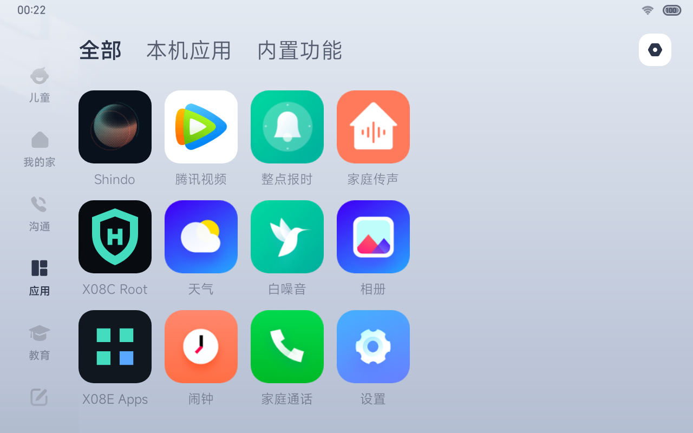

# X08E MicoLauncher Apps Mod 101.5.100

为 Redmi小爱触屏音箱Pro8（`X08E`，`com.xiaomi.micolauncher` `101.5.100-soundboxNormal` / `versionCode 1010005100`）重做的系统桌面「应用」分页，保留原生三行横向宫格、`Miuix SpringBackLayout` 回弹、圆角图标与字体风格，移除云端 AppStore 推广卡片，直接展示本机所有带自定义图标的应用与 8 项内置 UI 功能。



## 产物说明

- 完整修改版 APK（debug 签名，用于提取 DEX 或 `dex2oat` 生成 `oat/arm`）：[`../dist/x08e-micolauncher-v101.5.100.apk`](../dist/x08e-micolauncher-v101.5.100.apk)
  - 包名：`com.xiaomi.micolauncher`
  - 基础版本：`101.5.100-soundboxNormal`（`versionCode 1010005100`）
  - 签名证书 SHA-256：`47774f2b9492f457de5b7ca61932c91154af18e9153143b8af198c37e3394911`
  - SHA-256：`c0a776755cebcc96f0f7c8ff86e859343f3519a419aa7434ebd09b9c43c9a07a`
- 预编译 ART 产物包（`oat/arm/base.odex` + `oat/arm/base.vdex`）：[`../dist/x08e-micolauncher-v101.5.100-oat-arm.tar.gz`](../dist/x08e-micolauncher-v101.5.100-oat-arm.tar.gz)
  - SHA-256：`aa06fa55803b137542d0b3f0a609dc35eb71bb769f3feb7ddaa71f7c415e0a4d`
- 源码与脚本：
  - [`src/com/xiaomi/micolauncher/feature/appscreen/LocalAppsHelper.java`](src/com/xiaomi/micolauncher/feature/appscreen/LocalAppsHelper.java)
  - [`scripts/build_and_deploy.py`](scripts/build_and_deploy.py)

## 改动摘要

- **成人模式入口重定向（`classes4.dex`）**：
  - 将 `HomeTabConfig.APP_TAB`（`homepage/d$a`）与 `epgTab="aibox_screen_app"` 跳转目标（`module/h0$e`）由 `BlankAppFragment` 改挂为 `AppHomeFragment`。
- **本地标签与数据源（`classes4.dex` + `classes5.dex`）**：
  - `全部`（默认）：本机有图标应用（优先置顶 `rua.moe.shindo`、`moe.rua.x08croot`）+ 8 项内置 UI 功能（`天气`、`闹钟`、`整点报时`、`白噪音`、`家庭通话`、`家庭传声`、`相册`、`设置`）。
  - `本机应用`：枚举 `CATEGORY_LAUNCHER` 与 `CATEGORY_LEANBACK_LAUNCHER` 中带自定义图标的本机 APK。
  - `内置功能`：8 项经实机验证可用的 `mico://launcher/*` 内置路由。
- **自动过滤规则**：
  - 隐藏 `com.xiaomi.micolauncher`、`com.android.traceur`、`com.xiaomi.micovoip/.test.TestAc`，隐藏内部模板图标入口 `com.xiaomi.mico.appstore`、`com.xiaomi.mico.gallery`、`com.xiaomi.mico.settings`（保留 `com.xiaomi.mico.settings` 系统本体以供设置齿轮与 `mico://launcher/setup` 正常调用），并动态比对 `PackageManager.getDefaultActivityIcon()` 隐藏一切无自定义图标的应用。

## 部署方法（需临时 root ADB）

> 提示：由于原厂 `com.xiaomi.micolauncher` 使用小米系统签名且涉及系统共享权限，不要直接用 `adb install -r` 以 debug 签名覆盖安装。本方案通过替换 `/data/app/com.xiaomi.micolauncher-*/oat/arm/` 中的 `base.odex` 与 `base.vdex`（并将 DEX CRC32 对齐回原厂 `base.apk`）生效，不修改 `/system` 也不重刷 `boot`。

先使用 [`x08c-root`](../x08c-root/README.md) 启用 root ADB，再任选以下一种方式部署：

### 方式 A：使用脚本部署发布版 APK（推荐，适配同款机型上任意 `101.5.100-soundboxNormal`）

只需 Python 3 与 `adb`，无需 Android SDK：

```bash
python3 x08e-micolauncher/scripts/build_and_deploy.py \
  --deploy-apk dist/x08e-micolauncher-v101.5.100.apk \
  --serial <device_ip>:5555
```

脚本会自动备份原厂 `oat/arm` 至 `/data/local/tmp/micolauncher_oat_stock_backup/`，在设备上调用 `dex2oat --compiler-filter=quicken`，对齐 5 个 DEX 的 CRC32 后写入并重启桌面。

### 方式 B：直接解包放入预编译 `oat/arm` 产物（仅限匹配版本 `101.5.100-soundboxNormal`）

若设备当前为完全一致的原厂 `101.5.100-soundboxNormal` 更新包（DEX CRC32 一致）：

```bash
tar -xzf dist/x08e-micolauncher-v101.5.100-oat-arm.tar.gz -C /tmp/mico_oat
adb -s <device_ip>:5555 shell 'mkdir -p /data/local/tmp/micolauncher_oat_stock_backup /data/local/tmp/mico_patch'
adb -s <device_ip>:5555 push /tmp/mico_oat/oat/arm/base.odex /data/local/tmp/mico_patch/
adb -s <device_ip>:5555 push /tmp/mico_oat/oat/arm/base.vdex /data/local/tmp/mico_patch/
adb -s <device_ip>:5555 shell '
  APP_DIR=$(ls -d /data/app/com.xiaomi.micolauncher-* | head -n 1)
  cp -a "$APP_DIR/oat/arm/"* /data/local/tmp/micolauncher_oat_stock_backup/
  runcon u:r:shell:s0 am force-stop com.xiaomi.micolauncher
  (killall -9 com.xiaomi.micolauncher com.xiaomi.micolauncher:miot 2>/dev/null || true)
  rm -f "$APP_DIR/oat/arm/base.art"
  rm -rf /data/data/com.xiaomi.micolauncher/code_cache/*
  cp /data/local/tmp/mico_patch/base.odex "$APP_DIR/oat/arm/base.odex"
  cp /data/local/tmp/mico_patch/base.vdex "$APP_DIR/oat/arm/base.vdex"
  chown system:all_a33 "$APP_DIR/oat/arm/base.odex" "$APP_DIR/oat/arm/base.vdex"
  chmod 0644 "$APP_DIR/oat/arm/base.odex" "$APP_DIR/oat/arm/base.vdex"
  restorecon -R "$APP_DIR/oat/arm"
  rm -rf /data/local/tmp/mico_patch
  runcon u:r:shell:s0 am start -n com.xiaomi.micolauncher/.Launcher --es epgTab aibox_screen_app
'
```

## 从源码重建

准备从设备提取的原厂 `com.xiaomi.micolauncher` `base.apk`、JDK 17+、Android SDK（`android-30` 与 `build-tools`）及 `jadx`（含 `jadx-*-all.jar`）：

```bash
python3 x08e-micolauncher/scripts/build_and_deploy.py \
  --stock-apk /path/to/stock_base.apk \
  --keystore ~/.android/debug.keystore
```

## 恢复原厂 OAT（回滚）

```bash
adb -s <device_ip>:5555 shell '
  APP_DIR=$(ls -d /data/app/com.xiaomi.micolauncher-* | head -n 1)
  runcon u:r:shell:s0 am force-stop com.xiaomi.micolauncher
  cp -a /data/local/tmp/micolauncher_oat_stock_backup/* "$APP_DIR/oat/arm/"
  chown system:all_a33 "$APP_DIR/oat/arm/"*
  chmod 0644 "$APP_DIR/oat/arm/"*
  restorecon -R "$APP_DIR/oat/arm"
  runcon u:r:shell:s0 am start -n com.xiaomi.micolauncher/.Launcher
'
```

## 版权信息

```text
Powered by NyphexAI. Developed by Hikaru(i@rua.moe)
```
